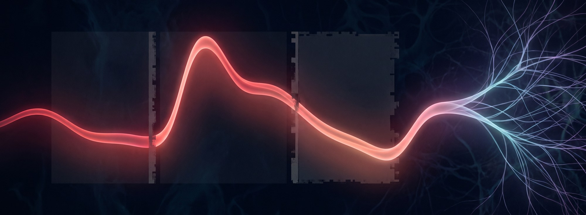

<em>What we lose when we divide the cardiac cycle into systole and diastole</em>

Comparing perception at systole, when the heart contracts, and diastole, when it relaxes between contractions, has become a familiar way to study how the heart influences the brain. Researchers use the ECG to time stimuli within a heartbeat, then interpret differences in performance in terms of cardiac afferent signalling. Baroreceptors are sensory neurons that respond to stretch in arterial walls as blood pressure changes. The usual rationale treats systole as a period of strong baroreceptor input and diastole as a period of little or no input, often simplified to “active” versus “silent”1,2. This approach owes much to Lacey and Lacey’s cardiac inhibition hypothesis: increased arterial baroreceptor activity during systole was proposed to inhibit central processing3. But does dividing the heartbeat into two categories fit what we know about the underlying neurophysiology? I think the human literature needs to take that question more seriously.

<h2 id="binning-imposes-a-model-of-cardiac-influence">1. Binning imposes a model of cardiac influence</h2>

Arterial baroreceptors respond to a changing mechanical stimulus. Pressure deforms the vessel wall, and the resulting stretch produces a pattern of neural firing that depends on the receptor’s response properties. Recordings from individual nerve fibres show different pressure thresholds for firing. Biophysical models also describe differences in how responses develop over time: some include sustained firing under maintained pressure, while others decline rapidly4,5.

Some of these responses can be sharply phasic. Continuous mechanical input can cross a threshold and produce a brief burst of firing. The problem with binning is that it averages over this temporal structure and assumes the chosen boundaries capture the relevant physiological distinction. The label “systole” tells us little about the shape of the population response within that interval.

Using systole versus diastole as the sole cardiac predictor assigns a single estimated effect to each window. The analysis asks whether those averages differ. It cannot describe systematic variation within either window, even though the physiology gives us reasons to expect it.

Consider a perceptual effect that follows arterial pressure continuously, or reaches its maximum some time after peak pressure. A broad window can dilute that effect by averaging its peak together with observations where it is small or absent. If the response changes sign within a window, averaging can cancel it out. And if its timing shifts between beats or people, the same effect may fall into different categories. In these circumstances, discretisation can reduce our power to detect a physiological relationship that a suitably specified continuous model could capture.

Different sensory populations also encode different bodily events. Stretch in an artery can signal rising pressure, while stretch in the stomach can signal filling. The vagus nerve carries signals from sensory populations specialised for the tissue they innervate and the stimuli they detect6. Arterial pressure sensing, for example, involves characteristic aortic nerve endings and force-sensitive PIEZO ion channels7,8. These specialisations help determine both the temporal response and its physiological meaning.

Even heartbeat-coupled signals can encode different quantities. Liu and colleagues identified cardiac mechanoreceptors in mice whose firing depended on blood volume and occurred around atrial and ventricular systole. Deleting Piezo2 in sensory neurons eliminated these responses while leaving the arterial baroreflex, the reflex that stabilises arterial blood pressure, intact9. A model of cardiac influence therefore needs to retain the temporal variation while specifying which sensory input could account for it.

<h2 id="ecg-timing-leaves-the-afferent-signal-unmeasured">2. ECG timing leaves the afferent signal unmeasured</h2>

The R-wave is the prominent ECG peak associated with ventricular electrical activation. The resulting contraction ejects blood into the arteries, producing a pressure wave that deforms tissue at the receptor site. Afferent signals then take time to reach and pass through the relevant central circuitry. A fixed offset from the R-wave collapses those processes into one assumed delay.

We already know that part of this delay varies. Payne and colleagues showed that the interval from the R-wave to the finger pulse includes a variable delay before blood is ejected. This complicates its interpretation as the pulse’s travel time through the arteries or a marker of blood pressure10. The recording site also matters: a finger pulse is measured in a different arterial bed from the aortic arch and carotid sinus, where arterial baroreceptors are concentrated.

Calling an R-wave offset “maximal baroreceptor activation” consequently makes a physiological claim that the ECG cannot establish. A chosen window may capture greater arterial afferent activity on average. It still leaves the magnitude and timing of that activity unknown for the particular beat being studied.

Continuous ECG phase still has physiological limitations. Scaling every interval between successive R-waves to the same duration can misalign mechanical events, because contraction and relaxation need not occupy fixed proportions of the beat11. Blood-pressure waveforms and estimates of ejection timing would let us relate behaviour more closely to the underlying haemodynamics.

<h2 id="central-effects-depend-on-the-circuit">3. Central effects depend on the circuit</h2>

Even a direct recording of baroreceptor firing would leave us with the question of how that input affects cognition. The nucleus of the solitary tract, or NTS, is a brainstem region that receives cardiovascular afferents alongside inputs from other organs. Its circuitry transforms those inputs before they influence downstream targets.

Ran and colleagues’ <em>A brainstem map for visceral sensations</em> shows how much processing occurs at this stage. In anaesthetised mice, many NTS neurons responded selectively to particular organs, and neurons with similar responses were spatially grouped. Blocking inhibition mediated by GABA allowed individual neurons to respond to a wider range of organs. Stimulating one organ could also suppress responses to another12. Here, inhibition helps determine which visceral inputs a neuron responds to. The study examined digestive and upper-airway inputs; its implications for cardiac processing need testing.

The NTS also filters cardiovascular input over time. In anaesthetised rats, Liu, Chen and Bonham found that faster stimulation of aortic baroreceptor fibres reduced the probability of an NTS neuron responding to each pulse. This reduction was greater in neurons further along the circuit13. Fewer responses per incoming pulse need not mean fewer responses overall when more pulses are arriving. Predicting a perceptual effect requires an account of how the downstream circuit uses that output.

There is evidence for specific inhibitory influences. In anaesthetised rats, Murase and colleagues demonstrated that baroreceptor stimulation could inhibit neurons in the locus coeruleus, a brainstem source of noradrenaline14. To explain a human task through that route, we need to establish how the change in noradrenaline affects the process being measured. Human motor-cortex experiments, for example, found greater excitability during systole15. A general appeal to cardiac inhibition gives us no clear way to predict that result.

Human experiments often invoke “baroreceptor activation” as though it specified the downstream mechanism. The animal work shows that both the sensory population and the receiving circuit require identification. We need an account of how their interaction changes a particular neural or behavioural response.

<h2 id="modelling-the-physiology">Modelling the physiology</h2>

I would start by making continuous models the default for cardiac-timing experiments. Sample across the cycle and estimate how the outcome varies with position within the heartbeat, including uncertainty about the shape of that relationship. This preserves the timing information available in the data and allows effects that extend across conventional window boundaries. A prespecified binary contrast can still be derived from the fitted response.

Continuous modelling should also allow the response shape to follow a physiological hypothesis. A narrow phasic effect requires a different description from a gradual change across the cycle. Fitting a single sine wave by habit can impose another unsuitable shape. The model’s flexibility should be justified in advance and supported by enough observations to estimate the proposed effect.

Measured haemodynamics would give these models a stronger physiological basis. A beat-to-beat pressure waveform allows us to test whether behaviour covaries with pressure or its rate of rise. We can also test a delayed relationship: the relevant neural or behavioural effect need not coincide with the pressure event that initiated it. Estimates of ejection timing and respiration would help account for variation between the electrical heartbeat and its mechanical consequences. The measurement site still matters; finger pressure can constrain an account of arterial input without directly measuring strain at the baroreceptor ending.

Ideally, a generative receptor model would inform the continuous predictor itself. Given a measured pressure waveform and an account of local mechanics, it would predict the time course of activity in a specified afferent population. Existing biophysical models provide a starting point5. A model of the receiving circuit could then predict when that activity should affect the neural response or behaviour being studied.

This would allow the predicted effect to shift with the physiology of each beat. Repeated observations could support estimates of person-specific timing and response strength. The model would make trial-level predictions from the available physiological measurements, carrying uncertainty forward when those measurements leave the afferent response ambiguous.

The test is whether these predictions improve on cardiac phase alone in data that were not used to fit the model, and anticipate the effects of an intervention. Stimulating carotid baroreceptors by changing pressure around the neck has demonstrated effects on pain and skeletal reflexes in humans16. Selective animal manipulations can isolate particular sensory populations9. With the accompanying cardiovascular changes measured, those experiments could test whether the model predicts the timing of an effect as well as its direction. That would give us a physiological reason to expect an effect at a particular moment, and a way to explain why that moment might change.

<h2 id="references">References</h2>

1. 

Al, E. <em>et al.</em> <a href="https://doi.org/10.1073/pnas.1915629117">Heart–brain interactions shape somatosensory perception and evoked potentials</a>. <em>Proceedings of the National Academy of Sciences</em> <strong>117</strong>, 10575–10584 (2020).

2. 

Garfinkel, S. N. <em>et al.</em> <a href="https://doi.org/10.1523/JNEUROSCI.3507-13.2014">Fear from the heart: Sensitivity to fear stimuli depends on individual heartbeats</a>. <em>Journal of Neuroscience</em> <strong>34</strong>, 6573–6582 (2014).

3. 

Lacey, B. C. &amp; Lacey, J. I. <a href="https://doi.org/10.1037/0003-066X.33.2.99">Two-way communication between the heart and the brain: Significance of time within the cardiac cycle</a>. <em>American Psychologist</em> <strong>33</strong>, 99–113 (1978).

4. 

Seagard, J. L. <em>et al.</em> <a href="https://doi.org/10.1161/01.res.66.6.1499">Firing characteristics of single-fiber carotid sinus baroreceptors</a>. <em>Circulation Research</em> <strong>66</strong>, 1499–1509 (1990).

5. 

Sturdy, J., Ottesen, J. T. &amp; Olufsen, M. S. <a href="https://doi.org/10.1007/s10827-016-0624-6">Modeling the differentiation of A- and C-type baroreceptor firing patterns</a>. <em>Journal of Computational Neuroscience</em> <strong>42</strong>, 11–30 (2017).

6. 

Zhao, Q. <em>et al.</em> <a href="https://doi.org/10.1038/s41586-022-04515-5">A multidimensional coding architecture of the vagal interoceptive system</a>. <em>Nature</em> <strong>603</strong>, 878–884 (2022).

7. 

Zeng, W. Z. <em>et al.</em> <a href="https://doi.org/10.1126/science.aau6324">PIEZOs mediate neuronal sensing of blood pressure and the baroreceptor reflex</a>. <em>Science</em> <strong>362</strong>, 464–467 (2018).

8. 

Min, S. <em>et al.</em> <a href="https://doi.org/10.1016/j.celrep.2019.10.040">Arterial baroreceptors sense blood pressure through decorated aortic claws</a>. <em>Cell Reports</em> <strong>29</strong>, 2192–2201.e3 (2019).

9. 

Liu, Z., Lu, S., <em>et al.</em> <a href="https://doi.org/10.1038/s41586-025-10010-4">Vagal blood volume receptors compensate for haemorrhage and posture change</a>. <em>Nature</em> <strong>651</strong>, 1068–1076 (2026).

10. 

Payne, R. A. <em>et al.</em> <a href="https://doi.org/10.1152/japplphysiol.00657.2005">Pulse transit time measured from the ECG: An unreliable marker of beat-to-beat blood pressure</a>. <em>Journal of Applied Physiology</em> <strong>100</strong>, 136–141 (2006).

11. 

Sherman, M. T., Wang, H.-T., Garfinkel, S. N. &amp; Critchley, H. D. <a href="https://doi.org/10.1016/j.biopsycho.2022.108291">The Cardiac Timing Toolbox (CaTT): Testing for physiologically plausible effects of cardiac timing on behaviour</a>. <em>Biological Psychology</em> <strong>170</strong>, 108291 (2022).

12. 

Ran, C. <em>et al.</em> <a href="https://doi.org/10.1038/s41586-022-05139-5">A brainstem map for visceral sensations</a>. <em>Nature</em> <strong>609</strong>, 320–326 (2022).

13. 

Liu, Z., Chen, C.-Y. &amp; Bonham, A. C. <a href="https://doi.org/10.1152/ajpheart.2000.278.2.H577">Frequency limits on aortic baroreceptor input to nucleus tractus solitarii</a>. <em>American Journal of Physiology–Heart and Circulatory Physiology</em> <strong>278</strong>, H577–H585 (2000).

14. 

Murase, S., Inui, K. &amp; Nosaka, S. <a href="https://doi.org/10.1016/0306-4522(94)90440-5">Baroreceptor inhibition of the locus coeruleus noradrenergic neurons</a>. <em>Neuroscience</em> <strong>61</strong>, 635–643 (1994).

15. 

Al, E. <em>et al.</em> <a href="https://doi.org/10.1371/journal.pbio.3002393">Cardiac activity impacts cortical motor excitability</a>. <em>PLOS Biology</em> <strong>21</strong>, e3002393 (2023).

16. 

Dworkin, B. R. <em>et al.</em> <a href="https://doi.org/10.1073/pnas.91.14.6329">Central effects of baroreceptor activation in humans: Attenuation of skeletal reflexes and pain perception</a>. <em>Proceedings of the National Academy of Sciences</em> <strong>91</strong>, 6329–6333 (1994).

