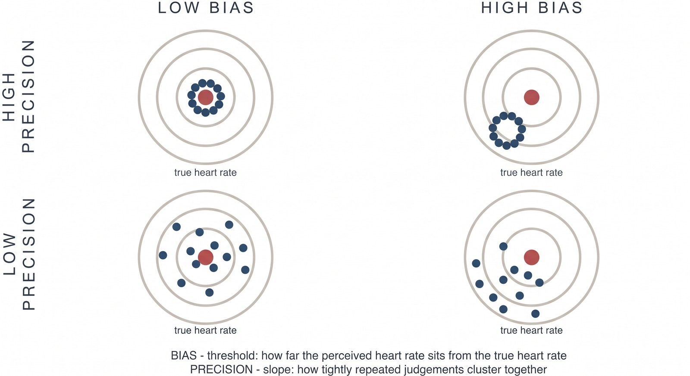
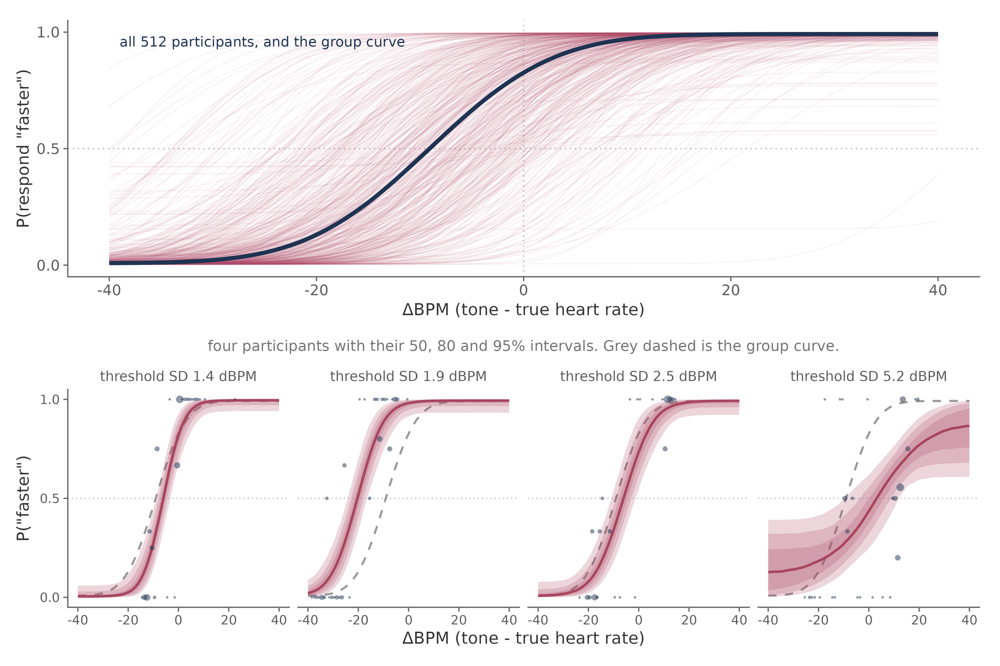
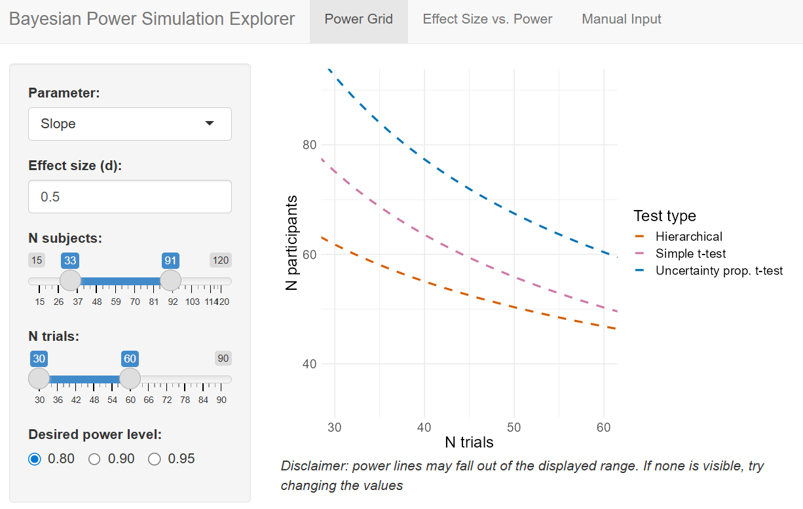

Our paper on <a href="https://doi.org/10.3758/s13428-026-03137-3">hierarchical Bayesian modelling of interoceptive psychophysics</a> is now published in <em>Behavior Research Methods</em>, with open access<a href="#ref-courtin2026" role="doc-biblioref">1</a>.<a href="#fn1" class="footnote-ref" id="fnref1" role="doc-noteref">1</a> It introduces models and analysis tools for the Heart Rate Discrimination task and the Respiratory Resistance Sensitivity task, together with empirical priors and an interactive tool for planning cardiac interoception studies.

Arthur Courtin and Jesper Fischer Ehmsen led the work as joint first authors, with Leah Banellis, Francesca Fardo and me. Arthur and Jesper put considerable care into developing and validating these models. I want to highlight what their work makes possible for researchers using these tasks: more efficient estimation, flexible experimental designs, and a documented workflow that uses familiar regression syntax in R.

<h2 id="making-better-use-of-psychophysical-data">Making better use of psychophysical data</h2>

Interoception research needs measures that distinguish perceptual bias, sensitivity and precision. Widely used measures, including heartbeat counting and self-report questionnaires, have limitations that make it difficult to establish which aspects of interoception they capture<a href="#ref-desmedt2023" role="doc-biblioref">2</a>,<a href="#ref-brener2016" role="doc-biblioref">3</a>. Psychophysical tasks address some of these problems by measuring how judgements change with a controlled stimulus.

In the Heart Rate Discrimination task, participants attend to their heartbeat, hear a sequence of tones, and judge whether the tones were faster or slower than their heart. Repeating this comparison at different tone rates allows us to estimate a psychometric function. Its threshold measures bias: whether someone tends to perceive their heart rate as faster or slower than it is. Its slope indexes precision: how sharply their judgements distinguish differences in rate. A person can be precise but consistently biased, or unbiased on average but imprecise. A single accuracy score obscures that distinction.

<figure>

<figcaption aria-hidden="true">Bias and precision are distinct. In this dartboard analogy, displacement from the centre represents bias, while a tighter cluster represents greater precision. In the cardiac task, these correspond to the threshold and slope of the psychometric function.</figcaption>
</figure>

The respiratory task asks participants which of two inhalations felt more difficult, with resistance added to one breath. Here the threshold measures sensitivity to inspiratory resistance. The interpretation differs from the cardiac task, but both require enough trials to estimate each participant’s response function reliably.

That requirement can make testing lengthy, especially for clinical or paediatric studies. Adaptive procedures help by choosing informative stimuli based on earlier responses. Analysis offers a further opportunity to reduce the amount of data needed.

The usual approach is to extract each participant’s threshold and slope from the adaptive procedure, then enter those estimates into a group analysis. This treats each estimate as an observed value, discarding its uncertainty. A threshold estimated precisely and one supported by very little information enter the analysis on the same footing. It also prevents information from being shared across participants during estimation.

<h2 id="from-individual-trials-to-group-inference">From individual trials to group inference</h2>

Our models jointly estimate individual psychometric functions and the population distributions from which their parameters are drawn. This allows partial pooling: estimates supported by less informative data are drawn more strongly towards the population distribution, while well-constrained estimates depend more on the individual’s responses. Uncertainty in those estimates remains part of the group analysis.

<figure>

<figcaption aria-hidden="true">Individual psychometric functions and the population curve for the 512 participants in the Cardioception tutorial dataset. The lower panels show four participants with increasing uncertainty in their thresholds; shaded bands show 50%, 80% and 95% credible intervals.</figcaption>
</figure>

Arthur and Jesper implemented the models in Stan, using Markov chain Monte Carlo sampling. They tested parameter and model recovery in simulations, then fitted the models to cardiac and respiratory data from the Visceral Mind Project. The cardiac analysis replicated the tendency for participants to underestimate their heart rate by approximately nine beats per minute when comparing it with an auditory reference.

<h2 id="specifying-experimental-designs-in-brms">Specifying experimental designs in brms</h2>

For me, the most useful aspect is the interface through brms. Researchers can specify predictors of psychometric parameters using the same formula syntax they would use for a mixed model in R. This makes it straightforward to compare patient groups, estimate drug effects within participants, or examine associations with age and symptom severity.

<table>
<colgroup>
<col style="width: 50%" />
<col style="width: 50%" />
</colgroup>
<thead>
<tr>
<th>Experimental design</th>
<th>Example predictor formula</th>
</tr>
</thead>
<tbody>
<tr>
<td>One group, one condition</td>
<td><code>~ 1 + (1 | subj)</code></td>
</tr>
<tr>
<td>Drug versus placebo, or pre versus post, within participants</td>
<td><code>~ condition + (condition | subj)</code></td>
</tr>
<tr>
<td>Patients versus controls</td>
<td><code>~ group + (1 | subj)</code></td>
</tr>
<tr>
<td>Association with standardised age</td>
<td><code>~ age_z + (1 | subj)</code></td>
</tr>
</tbody>
</table>

These formulas specify predictors of threshold or slope within the psychometric model; the tutorials provide the full model specification, priors and diagnostic checks. Predictors can affect either parameter or both. We have already used the within-participant approach extensively in our pharmacology studies.

The analysis returns posterior distributions for group effects and individual parameters, so both estimates and their uncertainty are available for interpretation. The paper’s demonstration models fitted data from 50 participants in approximately five minutes. Larger datasets and more complex designs take longer, but the workflow is practical on an ordinary research computer.

<h2 id="estimating-lapses-separately-from-precision">Estimating lapses separately from precision</h2>

One change is particularly relevant to researchers who have previously analysed the estimates returned by the adaptive procedure. The implementation used in our study fixed the lapse rate at 2% during data collection. This simplifies online stimulus selection, but assumes the same rate of occasional inattentive or mistaken responses for everyone.

The hierarchical model estimates lapse rates for individual participants. If the assumed lapse rate is too low, errors on otherwise easy trials can be attributed to a shallower psychometric function, making perception appear less precise. Estimating lapse rate separately reduces that risk, while retaining uncertainty when the data provide little information about it. This is a reason to refit the trial data when drawing conclusions about perceptual precision.

<h2 id="empirical-priors-for-future-studies">Empirical priors for future studies</h2>

The Visceral Mind Project also provides a basis for choosing informative priors. We analysed cardiac data from 513 participants and respiratory data from 267, then derived priors describing plausible thresholds, slopes, lapse rates and variation between participants.

These priors allow subsequent studies to use what we have already learned about performance on the tasks. They can help constrain estimates when trials or participants are limited, provided they are appropriate for the new population and design. The resources accompanying the paper include priors and updated scripts for initialising the adaptive procedure; the tutorials explain how to specify and check priors in the hierarchical models.

Priors also matter when the question concerns evidence for an absence of an effect. With justified priors on the effects being compared, Bayes factors can quantify relative support for null and alternative hypotheses. The empirical priors provide a useful starting point, although a prior describing baseline performance does not by itself determine the plausible size of a drug effect or a patient–control difference.

<h2 id="planning-trials-and-participants-together">Planning trials and participants together</h2>

We used simulations to compare the power of hierarchical analysis with conventional tests on estimates from the adaptive procedure. These simulations concerned a within-participant design with two cardiac task conditions, allowing us to vary the number of participants, trials per condition and effect size.

For a standardised threshold difference of 0.5, the fitted power analysis estimated that 20 participants completing 30 trials <strong>per condition</strong> would provide 80% power with hierarchical analysis. The conventional paired t-test required approximately 30 participants at the same trial count. Under these assumptions, the hierarchical approach reduced the required sample by a third.

The accompanying Shiny app makes these results available for study planning. Users can explore combinations of participants and trials that reach a chosen power level, or inspect the estimated power of a proposed design. The app runs locally from the repository and can be explored without writing analysis code once it is installed.

<figure>

<figcaption aria-hidden="true">The Shiny app’s power grid. Contours show combinations of participant numbers and trials per condition predicted to reach the selected power level for the simulated cardiac task design.</figcaption>
</figure>

The estimates depend on the simulation assumptions, so they should guide planning for comparable designs. They are not a general sample-size calculation for every cardiac or respiratory study. One practical result was consistent across our simulations: effects on slope required more data than effects on threshold. Studies of perceptual precision should account for that difference from the outset.

<h2 id="using-the-models">Using the models</h2>

The <a href="https://github.com/embodied-computation-group/Hierarchical-Interoception">Hierarchical Interoception repository</a> contains the models, empirical priors, a worked brms demonstration and the power app. The demonstration covers simulation, fitting, diagnostics, interpretation and reporting for both tasks.

The <a href="https://www.the-ecg.org/Cardioception/tutorials/index.html">Cardioception tutorials</a> provide a complementary route from raw cardiac task files to hierarchical analysis. They cover data inspection, individual psychometric functions, group models and covariates, with a separate tutorial on modelling confidence ratings. If you already have Heart Rate Discrimination data, these are a good place to begin. For the modelling rationale and validation, start with the <a href="https://doi.org/10.3758/s13428-026-03137-3">paper</a>.

Although developed for cardiac and respiratory interoception, the models also provide templates that can be adapted to other psychophysical tasks. We are moving our ongoing interoception projects onto this workflow, and I hope the documentation makes it easier for others to do the same.

Please cite the paper if you use the models or priors:

<blockquote>

Courtin, A. S., Ehmsen, J. F., Banellis, L., Fardo, F., &amp; Allen, M. G. (2026). Hierarchical Bayesian modeling of interoceptive psychophysics. <em>Behavior Research Methods</em>, 58, 260. <a href="https://doi.org/10.3758/s13428-026-03137-3" class="uri">https://doi.org/10.3758/s13428-026-03137-3</a>

</blockquote>

I will write more about our computational modelling work as it develops. Bug reports and feature requests are welcome on GitHub, and you are welcome to contact me about applying the models to your own data.

1. 

Courtin, A. S., Ehmsen, J. F., Banellis, L., Fardo, F. &amp; Allen, M. G. <a href="https://doi.org/10.3758/s13428-026-03137-3">Hierarchical bayesian modeling of interoceptive psychophysics</a>. <em>Behavior Research Methods</em> <strong>58</strong>, 260 (2026).

2. 

Desmedt, O., Luminet, O., Walentynowicz, M. &amp; Corneille, O. <a href="https://doi.org/10.1016/j.neubiorev.2023.105388">The new measures of interoceptive accuracy: A systematic review and assessment</a>. <em>Neuroscience &amp; Biobehavioral Reviews</em> <strong>153</strong>, 105388 (2023).

3. 

Brener, J. &amp; Ring, C. <a href="https://doi.org/10.1098/rstb.2016.0015">Towards a psychophysics of interoceptive processes: The measurement of heartbeat detection</a>. <em>Philosophical Transactions of the Royal Society B</em> <strong>371</strong>, 20160015 (2016).

<section id="footnotes" class="footnotes footnotes-end-of-document" role="doc-endnotes">

<ol>
<li id="fn1">
This was also one of the best peer-review experiences we have had. The reviewers knew their psychophysics and gave us a thorough grilling on the mathematical details. Their criticisms were rigorous, specific and constructive, and both the paper and the models are substantially better for it.<a href="#fnref1" class="footnote-back" role="doc-backlink">↩︎</a>
</li>
</ol>
</section>
